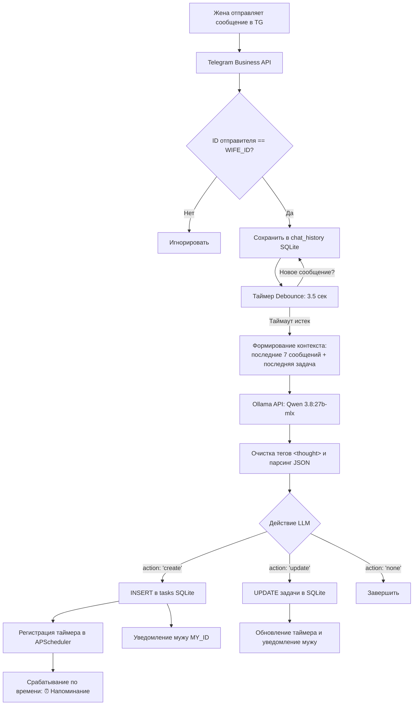

# 🤖 PersonalFamilyTasksBot

> **Автоматический семейный таск-трекер на базе Telegram Business API и локальной нейросети Ollama (Qwen 3.8)**

[](https://www.python.org/)
[](https://docs.aiogram.dev/)
[-black.svg?logo=ollama&logoColor=white)](https://ollama.com/)
[](https://sqlite.org/)
[](https://apscheduler.readthedocs.io/)
[](LICENSE)

---

## 💡 О проекте

Часто в семейной переписке важные бытовые просьбы и дела теряются в потоке сообщений: ссылки на маркетплейсы, списки покупок, визиты к врачу или напоминания оплатить счета.

**PersonalFamilyTasksBot** превращает ваш личный Telegram-аккаунт в персональный органайзер благодаря **Telegram Business API**:
1. Бот незаметно слушает входящие сообщения от жены в вашем личном диалоге.
2. Сохраняет контекст последних сообщений и объединяет быстрые реплики (дебаунсинг).
3. Локальная LLM (Qwen 3.8 / 27B) анализирует смысл переписки и выявляет поручения и дедлайны.
4. Создает или дополняет задачи в SQLite и устанавливает напоминания через APScheduler.
5. При наступлении дедлайна бот присылает уведомление в Telegram.

> 🔒 **100% Приватность:** Все сообщения анализируются исключительно на вашей локальной машине через Ollama. Личные данные не отправляются во внешние облачные API.

---

## ✨ Основные возможности

- **Перехват через Telegram Business API:**
  Используется событие `business_message` фреймворка `aiogram 3`. Бот подключен непосредственно к вашему бизнес-аккаунту Telegram и слушает личную переписку. Жесткая фильтрация по `WIFE_ID` игнорирует сообщения от любых других пользователей.

- **Умный контекст (Multi-message Window):**
  Хранит историю последних сообщений (`CONTEXT_HISTORY_LIMIT = 7`). Это позволяет решать жизненные сценарии:
  - **Ссылки ДО задачи:** Жена присылает 2–3 ссылки на маркетплейсы, а затем пишет: *«выбери игрушку для сына до пятницы»*. Бот объединяет суть и все ссылки в одну задачу.
  - **Ссылки ПОСЛЕ задачи:** Бот создал задачу *«Выбрать подарок»*, а через пару минут жена досылает варианты со ссылками. Бот распознает связь с недавней задачей и обновляет её в базе данных.

- **Дебаунсинг (Debouncing / Дебатчинг сообщений):**
  Если собеседник отправляет несколько коротких реплик подряд (*«купи»* → *«хлеб»* → *«и молоко»*), бот ждет настраиваемую паузу (по умолчанию `3.5` секунды), объединяя реплики в один пакет перед обращением к LLM. Это экономит ресурсы GPU/CPU и предотвращает создание дубликатов задач.

- **Локальный ИИ (Qwen 3.8:27b-mlx в Ollama):**
  - Запрос к Ollama API (`POST /api/generate`) с параметрами `format="json"`.
  - Динамическая подстановка текущей даты и дня недели для расчета относительных дедлайнов (*«завтра к 15:00»*, *«в субботу»*, *«через 2 часа»*).
  - Программная очистка Thinking-рассуждений: удаление тегов `<thought>...</thought>` и `<think>...</think>`, безопасный парсинг strict JSON.

- **Надежный планировщик дедлайнов (APScheduler):**
  При наличии дедлайна бот регистрирует точный таймер в `AsyncIOScheduler`. При перезапуске бота все активные задачи автоматически восстанавливаются из SQLite.

- **Интерактивные команды для мужа:**
  - `/tasks` — просмотр всех текущих активных задач с дедлайнами и прикрепленными ссылками.
  - `/done <id>` — отметка задачи как выполненной со снятием таймера напоминания.
  - `/start` — статус бота и проверка подключения.

---

## 📐 Архитектура системы



---

## 🛠 Требования

1. **Python 3.10+**
2. **Telegram Premium** (необходим для работы Telegram Business на вашем аккаунте)
3. **Локальный сервер Ollama** с установленной моделью (например, `qwen3.8:27b-mlx` или `qwen2.5:32b`, `qwen2.5:14b`, `qwen2.5:7b`).

---

## 🚀 Установка и быстрый старт

### 1. Клонирование репозитория

```bash
git clone https://github.com/your-username/PersonalFamilyTasksBot.git
cd PersonalFamilyTasksBot
```

### 2. Создание виртуального окружения

```bash
python3 -m venv venv
source venv/bin/activate  # На Windows: venv\Scripts\activate
pip install -r requirements.txt
```

### 3. Настройка переменных окружения

Скопируйте шаблон конфигурации `.env.example` в `.env`:

```bash
cp .env.example .env
```

Заполните параметры в `.env`:

```ini
# Токен бота (создается через @BotFather)
BOT_TOKEN=1234567890:ABCdefGHIjklMNOpqrsTUVwxyz

# Telegram ID жены (числовой ID)
WIFE_ID=111111111

# Ваш Telegram ID (куда бот присылает уведомления)
MY_ID=222222222

# Адрес локального Ollama
OLLAMA_URL=http://127.0.0.1:11434/api/generate
OLLAMA_MODEL=qwen3.8:27b-mlx
OLLAMA_TIMEOUT_SECONDS=120

# База данных SQLite
DB_PATH=tasks.db

# Настройки контекста и дебаунса
DEBOUNCE_DELAY_SECONDS=3.5
CONTEXT_HISTORY_LIMIT=7
```

> 💡 **Как узнать Telegram ID:** Отправьте любое сообщение боту `@userinfobot` или `@myidbot` со своего аккаунта и с аккаунта жены.

### 4. Подготовка Ollama

Убедитесь, что сервис Ollama запущен и модель загружена:

```bash
ollama run qwen3.8:27b-mlx
# или любая подходящая модель, например:
# ollama run qwen2.5:14b
```

---

## 📱 Подключение Telegram Business

Чтобы бот мог перехватывать входящие сообщения из вашего личного диалога:

1. Откройте Telegram на телефоне или компьютере (требуется подписка **Telegram Premium**).
2. Перейдите в: **Настройки** → **Telegram для бизнеса** (Telegram Business) → **Чат-боты** (Chatbots).
3. Введите username вашего бота (созданного в `@BotFather`).
4. Настройте разрешения:
   - **Доступ к чатам:** выберите *«Все чаты»* или укажите конкретно чат с женой.
   - Разрешите боту читать входящие сообщения.

---

## 🏃 Запуск бота

```bash
python3 bot.py
```

После запуска в консоли появится лог инициализации базы данных и планировщика:
```text
2026-10-12 15:45:00 [INFO] FamilyTasksBot: База данных SQLite инициализирована (таблицы 'tasks' и 'chat_history' готовы).
2026-10-12 15:45:00 [INFO] FamilyTasksBot: Планировщик APScheduler запущен.
2026-10-12 15:45:00 [INFO] FamilyTasksBot: Бот готов к обработке событий Telegram Business.
```

---

## 💬 Примеры работы

### Сценарий 1: Ссылки ДО формулировки задачи
```text
Жена: [15:10] Смотри какой классный конструктор https://market.yandex.ru/...
Жена: [15:10] Или вот такой робот https://ozon.ru/...
Жена: [15:11] Выбери игрушку для сына на день рождения до пятницы
```
**Результат бота:**
> 📥 **Новая задача от жены!**
> 
> 📌 **Суть:** Выбрать игрушку для сына на день рождения  
> 🔗 **Детали / ссылки:**  
> Варианты:  
> 1. https://market.yandex.ru/...  
> 2. https://ozon.ru/...  
> 📅 **Дедлайн:** 🕒 `2026-10-16 18:00:00` *(напоминание запланировано)*  
> 
> *Запись сохранена в базу (ID: #1)*

---

### Сценарий 2: Задача сначала, ссылки и детали позже
```text
Жена: [16:00] Не забудь заказать корм коту сегодня до 20:00!
(Бот создал задачу #2 с дедлайном 20:00)

Спустя пару минут:
Жена: [16:05] Вот этот бери с лососем: https://petshop.ru/item/...
```
**Результат бота:**
> ✏️ **Задача #2 обновлена!**
> 
> 📌 **Суть:** Заказать корм коту  
> 🔗 **Обновленные детали / ссылки:**  
> Вкус с лососем: https://petshop.ru/item/...  
> 📅 **Дедлайн:** `2026-10-12 20:00:00`  
> 
> *Данные задачи актуализированы на основе новых сообщений.*

---

## ⚙️ Команды в личном чате с ботом

| Команда | Описание |
| :--- | :--- |
| `/tasks` | Показать список всех активных задач с дедлайнами и прикрепленными ссылками |
| `/done <id>` | Отметить задачу как выполненную (таймер напоминания снимается) |
| `/start` | Проверить статус бота, модель LLM и текущие настройки |

---

## 📁 Структура проекта

```text
PersonalFamilyTasksBot/
├── bot.py             # Полный асинхронный скрипт бота (aiogram 3 + SQLite + APScheduler)
├── requirements.txt   # Зависимости Python
├── .env.example       # Шаблон конфигурации переменных окружения
├── README.md          # Документация проекта
└── tasks.db           # Локальная база SQLite (создается автоматически)
```

---

## 📄 Лицензия

Распространяется под лицензией [MIT](LICENSE). Вы можете свободно использовать, модифицировать и адаптировать проект под свои нужды.
