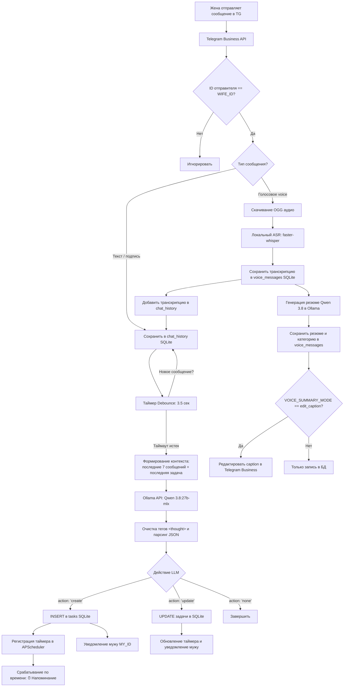

# 🤖 PersonalFamilyTasksBot

> **Автоматический семейный таск-трекер на базе Telegram Business API, локального распознавания речи (faster-whisper) и локальной нейросети Ollama (Qwen 3.8)**

[](https://www.python.org/)
[](https://docs.aiogram.dev/)
[](https://github.com/SYSTRAN/faster-whisper)
[-black.svg?logo=ollama&logoColor=white)](https://ollama.com/)
[](https://sqlite.org/)
[](https://apscheduler.readthedocs.io/)
[](LICENSE)

---

## 💡 О проекте

Часто в семейной переписке важные бытовые просьбы и дела теряются в потоке сообщений: ссылки на маркетплейсы, списки покупок, визиты к врачу или напоминания оплатить счета. Особенно часто просьбы отправляются в виде **голосовых сообщений**, которые неудобно слушать на работе или во время встреч.

**PersonalFamilyTasksBot** превращает ваш личный Telegram-аккаунт в персональный органайзер благодаря **Telegram Business API**:
1. Бот незаметно слушает входящие текстовые и **голосовые сообщения** от жены в вашем личном диалоге.
2. Голосовые сообщения мгновенно и **локально транскрибируются** через движок `faster-whisper` без передачи звука в облако.
3. Локальная LLM (Qwen 3.8 / 27B в Ollama) составляет емкое структурированное резюме голосового сообщения и классифицирует категорию (здоровье, быт, семья, покупки, планы).
4. Текст транскрипции встраивается в общий контекстный диалог и участвует в автоматическом извлечении задач.
5. При наличии дедлайна бот регистрирует напоминание в APScheduler и вовремя присылает уведомление мужу.
6. В опциональном режиме `edit_caption` бот может дополнить подпись голосового сообщения жены кратким резюме через Telegram Business API.

> 🔒 **100% Приватность и локальность:** Все аудиосообщения транскрибируются и анализируются исключительно на вашей локальной машине. Аудиофайлы и персональные переписки **не отправляются** во внешние облачные сервисы (OpenAI, Google Cloud, сторонние API).

---

## ✨ Основные возможности

- **Перехват через Telegram Business API:**
  Используется событие `business_message` фреймворка `aiogram 3`. Бот подключен непосредственно к вашему бизнес-аккаунту Telegram и слушает личную переписку. Жесткая фильтрация по `WIFE_ID` игнорирует сообщения от любых других пользователей.

- **Локальный голосовой интеллект (Local Speech-to-Text):**
  - Поддержка голосовых сообщений Telegram (`message.voice`, формат OGG/Opus).
  - Быстрое локальное распознавание русской речи через движок `faster-whisper` (CTranslate2).
  - Асинхронное исполнение в отдельном пуле потоков (`asyncio.to_thread`), не блокирующее event loop бота.
  - Повторное использование однажды загруженной модели в памяти (lazy loading & reuse).
  - Идемпотентность: защита от повторной обработки дубликатов голосовых сообщений.
  - Очередь обработки для строгого сохранения хронологии сообщений в контексте.

- **Умное резюмирование голосовых сообщений (Qwen 3.8):**
  - Автоматическое выделение сути и ключевых моментов в структурированный JSON.
  - Определение категории: `health`, `household`, `family`, `shopping`, `plans`, `work`, `other`.
  - **Специальные правила для здоровья (`health`):** сохранение точных симптомов и длительности без медицинского самолечения, постановки диагнозов или вымышленных подробностей.

- **Умный контекст (Multi-message Window):**
  Хранит историю последних сообщений (`CONTEXT_HISTORY_LIMIT = 7`). Голосовые сообщения и текстовые реплики объединяются в единый поток переписки. Это позволяет решать жизненные сценарии:
  - **Ссылки ДО задачи:** Жена присылает 2–3 ссылки на маркетплейсы, а затем голосом надиктовывает: *«выбери игрушку для сына до пятницы»*. Бот объединяет суть и все ссылки в одну задачу.
  - **Ссылки ПОСЛЕ задачи:** Бот создал задачу *«Выбрать подарок»*, а через пару минут жена присылает голосовое с пояснениями. Бот распознает связь с недавней задачей и обновляет её.

- **Дебаунсинг (Debouncing):**
  Если собеседник отправляет серию реплик подряд (текст + голосовое + уточнение), бот ждет настраиваемую паузу (по умолчанию `3.5` секунды), объединяя реплики в один пакет перед обращением к LLM.

- **Опциональное редактирование подписи голосового (`edit_caption`):**
  Через метод `editMessageCaption` бот может прикрепить резюме прямо к исходному голосовому сообщению в диалоге, не отправляя отдельных сообщений собеседнику.

- **Надежный планировщик дедлайнов (APScheduler):**
  При наличии дедлайна бот регистрирует точный таймер в `AsyncIOScheduler`. При перезапуске бота все активные задачи автоматически восстанавливаются из SQLite.

- **Двусторонняя синхронизация с Trello:**
  - **Добавление входящих задач в Trello:** При создании новой задачи в Telegram бот автоматически создает карточку в колонке `Inbox` / `Входящие` на вашей доске Trello с указанием сути, описания, ID задачи и дедлайна.
  - **Автоматическое закрытие через Callback (Webhook):** При переносе карточки в колонку `Done` / `Завершено` / `Выполнено` бот мгновенно отмечает задачу как выполненную в SQLite, снимает таймер напоминания и присылает подтверждение в Telegram.
  - **Надежный Fallback (систематическое сканирование):** Периодический опрос колонок Done гарантирует синхронизацию, даже если бот работает за NAT/роутером без внешнего IP или вебхук недоступен.
  - **Гибкий поиск колонок:** В конфиге можно указать списки колонок через запятую на русском и английском языках; бот автоматически находит нужные колонки на доске независимо от регистра и эмодзи (например: `📥 Входящие`, `Done`, `✅ Выполнено`).
  - **Ссылка на карточку:** Ссылка на созданную карточку Trello сразу прикрепляется к Telegram-уведомлению и отображается в команде `/tasks`.

- **Интерактивные команды для мужа:**
  - `/tasks` — просмотр всех текущих активных задач с дедлайнами, ссылками на карточки Trello и деталями.
  - `/done <id>` — отметка задачи как выполненной со снятием таймера напоминания и переносом карточки в Done в Trello.
  - `/start` — статус бота, параметры ASR, модель LLM, статус Trello и текущие настройки.

---

## 📐 Архитектура системы



---

## 🎙 Выбор модели ASR и системные требования

Для распознавания речи используется библиотека `faster-whisper`. Выбор размера модели задается переменной `ASR_MODEL_SIZE`:

| Размер модели | Объем памяти (RAM/VRAM) | Скорость на CPU | Качество распознавания (русский) | Рекомендация |
| :--- | :--- | :--- | :--- | :--- |
| `tiny` | ~150 МБ | Очень быстро | Базовое (могут быть опечатки) | Для слабых CPU |
| `base` | ~250 МБ | Быстро | Удовлетворительное | Баланс для мини-ПК |
| `small` **(рекомендуется)** | ~500 МБ | Средняя (~1-2 с на фразу) | **Отличное** | **Оптимальный выбор по умолчанию** |
| `medium` | ~1.5 ГБ | Медленнее | Высокое | При наличии мощного многоядерного CPU |
| `large-v3` | ~3 ГБ | Высокая нагрузка | Максимальное | Рекомендуется при наличии GPU |

### Аппаратные конфигурации:
- **Apple Silicon (Mac M1/M2/M3/M4):** `ASR_DEVICE=cpu`, `ASR_COMPUTE_TYPE=int8` (обеспечивает высокую скорость благодаря оптимизациям под ARM NEON).
- **ПК / Сервер с NVIDIA GPU:** `ASR_DEVICE=cuda`, `ASR_COMPUTE_TYPE=float16` (требуется установленный CUDA Toolkit и cuDNN).
- **Стандартный процессор x86_64:** `ASR_DEVICE=cpu`, `ASR_COMPUTE_TYPE=int8`.

> [!IMPORTANT]
> **Требования к версии Python для ASR (`faster-whisper`):**
> Библиотека `faster-whisper` зависит от `onnxruntime` и `ctranslate2`, скомпилированные сборки которых на PyPI поддерживают версии **Python 3.9 – 3.12**.
> Для распознавания голосовых сообщений используйте виртуальное окружение с Python 3.9–3.12 (например, через `pyenv` или `python3.11 -m venv .venv`). В репозитории уже настроено виртуальное окружение `.venv` на базе Python 3.9.2:
> ```bash
> source .venv/bin/activate
> ```
> Если бот запускается на Python 3.14+ без распознавания голоса, укажите в `.env`: `ASR_ENABLED=false`.

### Первичная загрузка модели:
При первом входящем голосовом сообщении `faster-whisper` автоматически загрузит выбранную модель из репозитория Hugging Face и сохранит в локальный кэш (`~/.cache/huggingface/hub`). После этого интернет-соединение для транскрибации больше не требуется.

---

## 🔒 Приватность и хранение аудио

- **Временные файлы:** По умолчанию (`VOICE_KEEP_AUDIO=false`) загруженные OGG-файлы сохраняются во временный файл и **автоматически удаляются** сразу после завершения транскрибации.
- **Постоянное хранение:** При установке `VOICE_KEEP_AUDIO=true` аудиофайлы сохраняются в каталоге `VOICE_AUDIO_DIR` (по умолчанию `voice_audio/`).
- **Логирование:** В логах бота **никогда не выводятся** полные тексты транскрипций, резюме, токены или бинарный звук. Фиксируются только метаданные: длительность, размер файла, число распознанных символов и затраченное время.
- **Отключение голосового модуля:** Чтобы отключить распознавание голосовых сообщений, установите `ASR_ENABLED=false`.

---

## 📝 Telegram Business: Режимы резюмирования

Параметр `VOICE_SUMMARY_MODE` регулирует отображение резюме:
1. `db_only` **(по умолчанию):**
   - Транскрипция и резюме сохраняются в SQLite-таблице `voice_messages`.
   - Транскрипция передается в контекст задач.
   - Никаких видимых изменений или сообщений жене в Telegram не отправляется.
2. `edit_caption`:
   - Бот пытается дополнить исходное голосовое сообщение жены подписью с кратким резюме через Telegram Business API (`editMessageCaption`).
   - Если исходное сообщение уже имело подпись, резюме дописывается ниже с сохранением исходного текста.
   - Учитывается лимит Telegram на длину подписи в 1024 символа (при необходимости резюме аккуратно сокращается).
   - *Важно:* Telegram разрешает редактирование сообщений в течение 48 часов с момента отправки при наличии соответствующих прав у бота в подключении Telegram Business. Если редактирование не поддерживается или завершилось ошибкой, бот сохраняет данные в БД и не спамит жене отдельными сообщениями.

---

## 🚀 Установка и быстрый старт

### 1. Клонирование репозитория

```bash
git clone https://github.com/your-username/PersonalFamilyTasksBot.git
cd PersonalFamilyTasksBot
```

### 2. Создание виртуального окружения

```bash
python3 -m venv venv
source venv/bin/activate  # На Windows: venv\Scripts\activate
pip install -r requirements.txt
```

### 3. Настройка переменных окружения

Скопируйте шаблон конфигурации `.env.example` в `.env`:

```bash
cp .env.example .env
```

Заполните параметры в `.env`:

```ini
# Токен бота (создается через @BotFather)
BOT_TOKEN=1234567890:ABCdefGHIjklMNOpqrsTUVwxyz

# Telegram ID жены (числовой ID)
WIFE_ID=111111111

# Ваш Telegram ID (куда бот присылает уведомления)
MY_ID=222222222

# Часовой пояс задач и напоминаний (по умолчанию UTC+4)
# Поддерживаются форматы: UTC+4, UTC+04:00, +04:00, Asia/Dubai, Europe/Moscow, Europe/Samara и др.
TIMEZONE=UTC+4

# Адрес локального Ollama
OLLAMA_URL=http://127.0.0.1:11434/api/generate
OLLAMA_MODEL=qwen3.8:27b-mlx
OLLAMA_TIMEOUT_SECONDS=120

# База данных SQLite
DB_PATH=tasks.db

# Настройки контекста и дебаунса
DEBOUNCE_DELAY_SECONDS=3.5
CONTEXT_HISTORY_LIMIT=7

# Настройки Speech-to-Text (faster-whisper)
ASR_ENABLED=true
ASR_MODEL_SIZE=small
ASR_DEVICE=cpu
ASR_COMPUTE_TYPE=int8
ASR_LANGUAGE=ru
ASR_BEAM_SIZE=5
ASR_TIMEOUT_SECONDS=300
ASR_MAX_FILE_SIZE_MB=30

# Режим вывода резюме голосовых сообщений (db_only / edit_caption)
VOICE_SUMMARY_MODE=db_only

# Хранение аудио
VOICE_KEEP_AUDIO=false
VOICE_AUDIO_DIR=voice_audio

# Интеграция с Apple Calendar через CalDAV
CALDAV_ENABLED=false
CALDAV_URL=https://caldav.icloud.com/
CALDAV_USERNAME=your_apple_id_here
CALDAV_PASSWORD=your_app_specific_password_here
CALDAV_CALENDAR_NAME=Personal
```

> 💡 **Как узнать Telegram ID:** Отправьте любое сообщение боту `@userinfobot` или `@myidbot` со своего аккаунта и с аккаунта жены.

### 4. Подготовка Ollama

Убедитесь, что сервис Ollama запущен и модель загружена:

```bash
ollama run qwen3.8:27b-mlx
# или любая подходящая модель, например:
# ollama run qwen2.5:14b
```

---

## 📱 Подключение Telegram Business

Чтобы бот мог перехватывать входящие сообщения из вашего личного диалога:

1. Откройте Telegram на телефоне или компьютере (требуется подписка **Telegram Premium**).
2. Перейдите в: **Настройки** → **Telegram для бизнеса** (Telegram Business) → **Чат-боты** (Chatbots).
3. Введите username вашего бота (созданного в `@BotFather`).
4. Настройте разрешения:
   - **Доступ к чатам:** выберите *«Все чаты»* или укажите конкретно чат с женой.
   - Разрешите боту читать входящие сообщения.
   - *(Опционально при `VOICE_SUMMARY_MODE=edit_caption`)*: разрешите боту отвечать/редактировать сообщения.

---

## 🏃 Запуск бота

```bash
python3 bot.py
```

После запуска в консоли появится лог инициализации базы данных и планировщика:
```text
2026-11-10 14:00:00 [INFO] FamilyTasksBot: База данных SQLite инициализирована (таблицы 'tasks', 'chat_history' и 'voice_messages' готовы).
2026-11-10 14:00:00 [INFO] FamilyTasksBot: Планировщик APScheduler запущен.
2026-11-10 14:00:00 [INFO] FamilyTasksBot: Бот готов к обработке событий Telegram Business.
```

---

## 🧪 Запуск автоматических тестов

В проекте реализован полный набор модульных и интеграционных тестов с моками Telegram Bot API и Ollama (без требования наличия реальных токенов или скачивания весов Whisper):

```bash
pytest
```

Все 32 теста проверяют:
- Сохранение поведения текстовых сообщений
- Обработку голосовых сообщений жены и игнорирование других отправителей
- Извлечение задач из голосовых сообщений
- Корректную работу при отсутствии поручений в голосовом
- Обработку сбоев скачивания, сбоев ASR и сбоев LLM-резюмирования
- Редактирование подписи и защиту при ошибках Telegram API
- Миграцию базы данных с сохранением старых задач и историй
- Работу планировщика напоминаний APScheduler

---

## 💬 Примеры работы

### Сценарий 1: Голосовое сообщение с поручением и дедлайном
```text
Жена [Голосовое сообщение 12 с]:
«Привет! Не забудь, пожалуйста, сегодня до восьми вечера забрать посылку из СДЭКа, код 458-12.»
```
**Результат бота в личном чате мужа:**
> 📥 **Новая задача от жены!**
> 
> 📌 **Суть:** Забрать посылку из СДЭКа  
> 🔗 **Детали / ссылки:** Код: 458-12  
> 📅 **Дедлайн:** 🕒 `2026-11-10 20:00:00` *(напоминание запланировано)*  
> 
> *Запись сохранена в базу (ID: #3)*

---

### Сценарий 2: Голосовое сообщение о самочувствии (health)
```text
Жена [Голосовое сообщение 25 с]:
«У меня сегодня весь день болит голова и слабость, посплю пару часов.»
```
**Запись в SQLite (`voice_messages`):**
- **Категория:** `health`
- **Резюме:** *Жена сообщает о плохом самочувствии: сильная головная боль в течение дня и слабость, пошла отдыхать.*
- **Ключевые моменты:**
  - Головная боль в течение дня
  - Слабость
- **Задачи:** Не создаются (так как поручений мужу нет).

---

---

## 📋 Интеграция с Trello

Бот поддерживает полноценную двустороннюю синхронизацию с Trello:

1. **Создание карточек в Inbox:**
   При фиксации новой задачи в Telegram создается карточка в колонке `Inbox` / `Входящие`. В карточку заносятся суть задачи, ID, ссылки/детали и срок дедлайна (`due date`).
2. **Завершение через Callback (вебхук) и Polling:**
   При перемещении карточки в колонку `Done` / `Завершено` / `Выполнено` в Trello бот немедленно переводит статус задачи в SQLite в `completed`, отменяет таймер напоминания и уведомляет мужа в Telegram.
3. **Закрытие из Telegram с переносом в Done Trello:**
   При нажатии inline-кнопки `[✅ Завершить]` или вводе `/done <id>` бот автоматически перемещает привязанную карточку в колонку `Done` на доске Trello.
4. **Обратная синхронизация переименования из любой колонки:**
   Если вы отредактировали заголовок, описание или дедлайн карточки прямо в Trello (в любой колонке — например, исправили неточно понятый ИИ текст), изменения мгновенно синхронизируются в базу SQLite (через вебхук или фоновое сканирование открытых карточек). При наступлении дедлайна напоминание отправит актуальный текст из Trello!
5. **Гибкий поиск колонок (кириллица + латиница):**
   В `.env` через разделитель (по умолчанию запятая `,`) можно перечислить любые варианты названий колонок:
   ```env
   TRELLO_INBOX_LISTS=Inbox, Входящие, Новые, To Do
   TRELLO_DONE_LISTS=Done, Завершено, Выполнено, Готово, Сделано
   ```

### 🔑 Как получить API-ключи Trello:
1. Перейдите в [Trello Power-Up Admin](https://trello.com/power-ups/admin) и создайте новое приложение / Power-Up (или откройте существующее).
2. Скопируйте **API Key** (`TRELLO_API_KEY`) и **API Secret** (`TRELLO_API_SECRET`).
3. Сгенерируйте **User Token** (`TRELLO_TOKEN`) по ссылке (подставив свой API Key):
   ```text
   https://trello.com/1/authorize?expiration=never&scope=read,write&response_type=token&key=ВАШ_API_KEY
   ```
4. Узнайте **ID доски** (`TRELLO_BOARD_ID`): он содержится в URL доски: `https://trello.com/b/BOARD_ID/название-доски`.

---

## 🗓 Интеграция с Apple Calendar через CalDAV

Бот автоматически разделяет входящие поручения на категории:
- `task`: обычные домашние дела, покупки и поручения.
- `calendar`: приемы врачей, записи на процедуры, онлайн-созвоны и встречи с точной датой и временем (например: *"Идем к остеопату 25 ноября в 9:00, адрес ул. Ленина 5, тел врача +7999..."*).

Для событий категории `calendar` ИИ извлекает:
- Название и точную дату/время начала
- `location`: адрес или место проведения
- `meeting_url`: ссылку для созвона (Zoom, Meet, Telemost)
- `contact_info`: контактное лицо и телефон врача/специалиста

При включенной опции `CALDAV_ENABLED=true` событие автоматически создается в календаре Apple (iCloud) через протокол CalDAV (по стандарту iCalendar VEVENT).

### 🔑 Настройка CalDAV для Apple iCloud:
1. Зайдите на [appleid.apple.com](https://appleid.apple.com) в раздел **Вход и безопасность** -> **Пароли приложений**.
2. Сгенерируйте новый пароль приложения для бота.
3. Укажите в `.env`:
   ```ini
   CALDAV_ENABLED=true
   CALDAV_URL=https://caldav.icloud.com/
   CALDAV_USERNAME=ваш_apple_id@icloud.com
   CALDAV_PASSWORD=abcd-efgh-ijkl-mnop
   CALDAV_CALENDAR_NAME=Personal
   ```

---

## ⚙️ Команды в личном чате с ботом

| Команда / Действие | Описание |
| :--- | :--- |
| `[✅ Завершить]` | Inline-кнопка под уведомлением о создании, под напоминанием и в `/tasks` — закрывает задачу в один клик |
| `/tasks` | Список всех активных задач с inline-кнопками завершения, дедлайнами, контактами, ссылками на встречи и карточки Trello |
| `/done <id>` | Отметить задачу как выполненную вручную (снимает напоминание и перемещает карточку в Done в Trello) |
| `/start` | Проверить статус бота, часовой пояс (UTC+4), состояние ASR, модель LLM, статус Trello и CalDAV |

---

## 📁 Структура проекта

```text
PersonalFamilyTasksBot/
├── bot.py                  # Главный скрипт бота (aiogram 3 + SQLite + APScheduler + Trello + CalDAV)
├── tz_utils.py             # Управление часовыми поясами (по умолчанию UTC+4, поддержка IANA и смещений)
├── calendar_sync/          # Пакет интеграции с Apple Calendar через CalDAV
│   ├── __init__.py
│   ├── config.py           # Конфигурация учетной записи CalDAV / iCloud
│   └── service.py          # Сервис формирования iCalendar VEVENT и работы с CalDAV
├── trello/                 # Модуль интеграции с Trello
│   ├── __init__.py
│   ├── config.py           # Конфигурация Trello API и парсинг колонок
│   ├── client.py           # Асинхронный REST-клиент Trello API (aiohttp)
│   ├── matcher.py          # Поиск и сопоставление колонок (кириллица, латиница, эмодзи)
│   ├── webhook.py          # Встроенный HTTP-сервер для приема вебхуков Trello и HMAC-проверка
│   └── service.py          # Оркестратор синхронизации задач, fallback-сканирования и событий
├── voice/                  # Пакет локальной обработки голосовых сообщений
│   ├── __init__.py
│   ├── config.py           # Конфигурация ASR, режимов и путей
│   ├── asr.py              # Локальный движок распознавания речи faster-whisper
│   ├── summary.py          # Генерация структурированного резюме через Qwen 3.8
│   ├── db.py               # Операции с таблицей voice_messages и миграции
│   └── processor.py        # Оркестрация конвейера обработки голосовых
├── tests/                  # Набор автоматических тестов (pytest)
│   ├── conftest.py         # Фикстуры тестовой БД и моков
│   ├── test_asr.py         # Тесты движка ASR
│   ├── test_summary.py     # Тесты промптов и генерации резюме
│   ├── test_db.py          # Тесты SQLite и миграции
│   ├── test_trello.py      # Тесты интеграции с Trello (клиент, matcher, webhook, polling, бот)
│   ├── test_voice_pipeline.py # Тесты конвейера обработки голоса
│   ├── test_bot_integration.py # Интеграционные тесты Telegram Business
│   └── test_new_features.py   # Тесты часового пояса, inline кнопок, CalDAV и обратной синхронизации Trello
├── requirements.txt        # Зависимости Python
├── .env.example            # Шаблон конфигурации переменных окружения
├── pytest.ini              # Конфигурация запуска тестов
├── README.md               # Документация проекта
└── tasks.db                # Локальная база SQLite (создается автоматически)
```

---

## 📄 Лицензия

Распространяется под лицензией [MIT](LICENSE). Вы можете свободно использовать, модифицировать и адаптировать проект под свои нужды.
